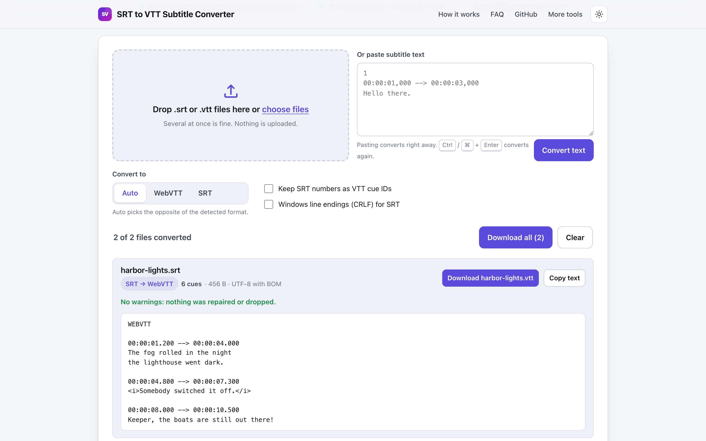
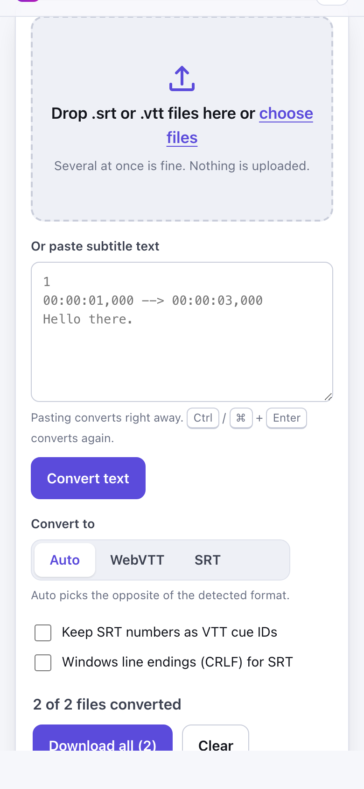

# SRT to VTT Subtitle Converter

> Convert SRT subtitles to WebVTT and back in your browser, in batches, with nothing uploaded.

**🌐 Use it now: [turhe123.github.io/srt-to-vtt-converter](https://turhe123.github.io/srt-to-vtt-converter/)** · free · open source · runs in your browser · works offline


## Why

This is a free, open-source alternative to Subtitle Converter sites such as Subtitle Tools and online SRT to VTT converters (upload your subtitle file to a server, ads, one file at a time). Here your files never leave the device, there is no account, no ads and no limits on how many files you convert, and it works offline and can be installed as an app.

## Screenshots

<p align="center"></p>

<p align="center"><em>SRT to VTT Subtitle Converter in the browser, light theme</em></p>

<p align="center"></p>

<p align="center"><em>SRT to VTT Subtitle Converter on a phone</em></p>

## Features

- Converts SRT to WebVTT and WebVTT to SRT, in both directions.
- Batch conversion: drop or choose many files at once, or paste subtitle text into the paste box.
- Detects the input format from the content, not just the file extension.
- Target selector: Auto (the opposite of the detected format), WebVTT or SRT.
- Decodes UTF-8 (with BOM removal), UTF-16 (by byte order mark) and falls back to Windows-1252.
- SRT to VTT: adds the `WEBVTT` header, turns timestamp commas into dots, and drops numeric indexes unless "Keep SRT numbers as VTT cue IDs" is ticked.
- VTT to SRT: removes the header, NOTE, STYLE and REGION blocks and cue settings such as position and align, numbers cues from one, and adds hours when missing. Optional CRLF line endings for SRT.
- Keeps cue text, line breaks and basic tags; unsupported markup such as font tags and `{\an8}` codes is removed and reported.
- One card per file with name, detected format, cue count, size, encoding, a list of warnings (repaired or dropped content) and a preview of the first lines.
- Download each result, Copy text, or Download all (saves each file separately, one after another; there is no ZIP). Output names swap the extension.
- Files that are not text show a visible error on their card instead of failing silently.
- Keyboard friendly: Ctrl/Cmd+V pastes into the focused box and converts, Ctrl/Cmd+Enter converts again.
- Light and dark themes, responsive down to phone widths, installable and usable offline.

**Input:** `.srt`, `.vtt` (and `.txt`) files, or pasted text.
**Output:** `.srt` and `.vtt`, UTF-8.
**Limits:** files over 100 MB are rejected with a message; binary files are rejected. Everything is processed in memory in your browser, so very large files depend on your device.

## How to use

1. Open the page and drop one or more `.srt` or `.vtt` files onto the drop zone, choose them with the file picker, or paste text into the paste box.
2. Leave "Convert to" on Auto, or pick WebVTT or SRT. Optionally keep SRT numbers as cue IDs or use CRLF line endings.
3. Check each card: the cue count, the warnings and the preview.
4. Click Download on a card, Copy text, or Download all to save every result.

## Privacy

- Nothing is uploaded. Files are read and converted on your device with browser APIs.
- No cookies and no account.
- Page views are counted anonymously with [GoatCounter](https://www.goatcounter.com/) (cookieless, open source). This is the only network request the page makes.
- After the first visit a service worker caches the page so it works offline.

## Run it locally

No build step.

```sh
git clone https://github.com/turhe123/srt-to-vtt-converter
cd srt-to-vtt-converter
python3 -m http.server 4173
```

Then open http://127.0.0.1:4173/

## Tests

```sh
npm i -D @playwright/test && npx playwright install chromium
npx playwright test
```

## Third-party code

None: browser APIs only.

## Built with AI

SRT to VTT Subtitle Converter was written by [Claude Code](https://claude.com/claude-code) inside an automated pipeline, from a plain-English spec. No code or assets from any commercial product were used; it is a clean-room implementation of a feature set, not a copy.

What that means in practice:

- The full source is in this repo under the MIT license. Read it before you trust it with your files.
- Everything runs in your browser. It makes no network requests except an anonymous, cookieless page-view count (GoatCounter); your files never leave the device.
- The page is tested headless in Chromium (Playwright) before every release, but it has had less human review than hand-written software. Bug reports and pull requests are welcome.

## Support ❤️

If this saved you time, you can say thanks on Ko-fi: https://ko-fi.com/leodavidai

## More free web tools

See the rest of the collection: https://turhe123.github.io/web-tools/

## License

MIT © Or Davidai Bachar
